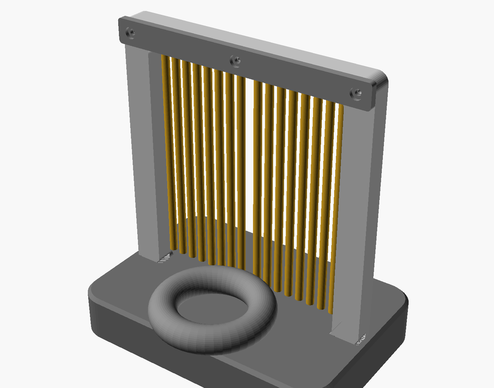

# Bead-curtain motor-skills toy (3D printed)

A home-printable version of the therapy "chain curtain" toy: a weighted base,
a U-shaped frame, and a curtain of ball chains hanging from the top bar that a
baby can bat, grab and pull. Sized to print on a Bambu Lab A1 mini in plain
grey PLA. Finished size is about 160 x 110 mm footprint, 176 mm tall (roughly
half the size of the original in the photos).



## Files

| File               | What it is                                                    |
|--------------------|---------------------------------------------------------------|
| `bead_curtain.scad`| Parametric OpenSCAD source. Everything below is generated from it. |
| `frame.stl`        | U frame with the chain "comb" in the top bar. Prints flat.     |
| `cover.stl`        | Strip that closes the comb once the chains are in.             |
| `base.stl`         | Hollow base, already flipped so the cavity faces up for printing. |
| `plate.stl`        | Bottom plate that closes the base after you add ballast.       |
| `ring.stl`         | Optional grab ring (a silicone teething ring works just as well). |

## Shopping list

| Item | Notes |
|------|-------|
| ~2.5 m of **#10 ball chain** (4.5 mm balls) | Stainless steel preferred, since she will mouth it. Sold as "large ball chain" / ceiling-fan pull chain. Nickel-plated steel also works. |
| 3 x M3 x 8 mm screws | Hold the cover on. Pan or button head. Superglue works instead. |
| 4 x M3 x 8 mm screws | Hold the base plate on. |
| ~250 g dry rice, sand or coins | Ballast for the base. |
| Flush cutters | To cut the chain between balls. |

If you can only get **#6 ball chain** (3.2 mm balls, the standard lamp
pull-chain size), open the `.scad`, set `chain_size = 6;` and re-export the
`frame.stl`. The comb resizes itself (20 strands instead of 16). #10 is the
better choice: it is about twice as strong and the balls are too big to be any
kind of choking hazard even if a link ever failed.

## Print settings (Bambu Studio, A1 mini, PLA)

| Part   | Orientation                         | Walls | Infill | Supports | Approx. weight |
|--------|-------------------------------------|-------|--------|----------|----------------|
| frame  | As exported (flat on its back)      | 4     | 30 %   | No       | 90 g           |
| cover  | As exported (flat)                  | 3     | 20 %   | No       | 8 g            |
| base   | As exported (cavity up)             | 3     | 15 %   | No       | 110 g          |
| plate  | As exported (flat)                  | 3     | 15 %   | No       | 20 g           |
| ring   | As exported (flat)                  | 3     | 15 %   | No       | 45 g           |

* Layer height 0.2 mm is fine everywhere.
* For the **frame**, turn on *Detect thin walls* (Quality > Advanced) so the
  1 mm shelf in each comb pocket prints cleanly. Four walls make the uprights
  stiff enough for a baby leaning on them.
* No part needs supports. The base's chamfered top edge becomes a 45 degree
  overhang at the bottom of the print, which PLA handles without help.
* Everything fits the 180 x 180 bed; the frame is the largest at 150 x 165 mm.
  Print it alone, on a clean, wiped plate, for good first-layer adhesion.

## Assembly

1. **Ballast the base.** With the printed base cavity-up, pour in rice, sand or
   coins until level with the tops of the bosses. Fit the plate and drive the
   four M3 screws straight into the 2.6 mm holes (they self-tap into PLA).
   Turn the base over.
2. **Cut the chains.** Cut 16 lengths of chain, each 22 balls long for #10
   (about 124 mm). Cut the bar *between* two balls with flush cutters so each
   end is a ball with a tiny stub. Snip any sharp stub flush.
3. **Load the comb.** Lay the frame flat, comb pockets facing up. Each pocket
   is a keyhole: a wide channel at the bottom, a narrow neck, and a wide pocket
   above. Push the last ball of a chain sideways into the top pocket, with the
   bar between the last two balls dropping into the neck. The rest of the
   chain lies in the channel and hangs out the bottom of the bar. Repeat for
   all 16 strands.
4. **Fit the cover.** Lay the cover strip over the comb and drive the three M3
   screws (or glue it with CA). The cover only stops chains sliding out
   sideways; the neck is what carries the load, so the cover is not
   structural.
5. **Fit the frame.** Press the two tenons at the bottom of the frame into the
   sockets in the base. They are a 0.25 mm clearance fit; a drop of CA glue on
   each tenon makes it permanent. If your printer prints tight, sand the
   tenons lightly; if loose, lower `fit` in the `.scad` and reprint the base.
6. Put the ring on the base in front of the curtain.

## Safety notes

* Check every chain end for burrs after cutting; file or snip smooth.
* Ball chain is strong, but check the strands occasionally and replace any
  that look stretched. With #10 chain the balls (4.5 mm) are big enough not
  to be swallowable, and each strand is only ~120 mm, so no strangulation
  loop can form.
* PLA is safe to mouth but hard to sanitise because of layer lines. If she
  chews the ring a lot, swap it for a silicone teething ring.
* Wipe the chains with soapy water now and then; stainless chain will not
  rust or flake.

## Tweaking

Everything is a variable at the top of `bead_curtain.scad`:

* `W`, `H`: frame width and height. Keep `W` <= 165 and `H + 15` <= 175 for
  the A1 mini bed.
* `BL`, `BW`, `BH`: base size. Make it bigger if she pulls the toy over.
* `strands_side`, `pitch`: how many chains and how far apart.
* `chain_size`: 10 or 6, see above.

Regenerate a part with, for example:

```
openscad -o frame.stl -D 'part="frame"' bead_curtain.scad
```
